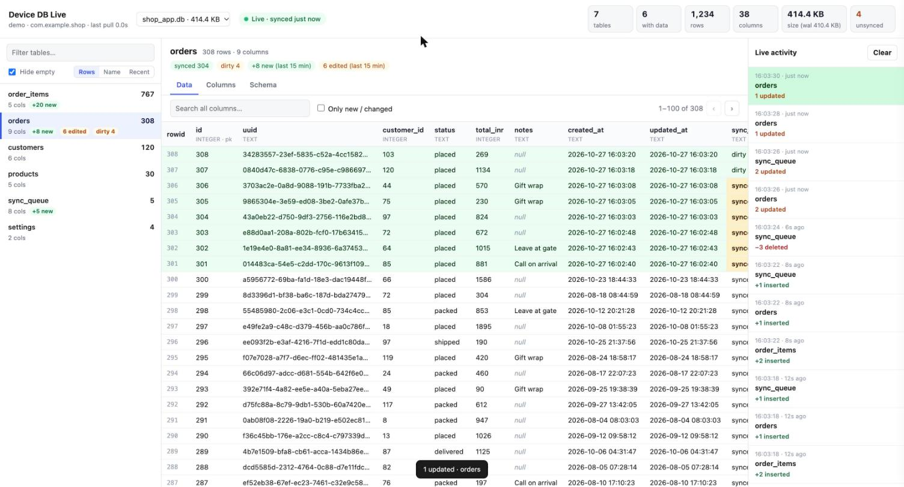
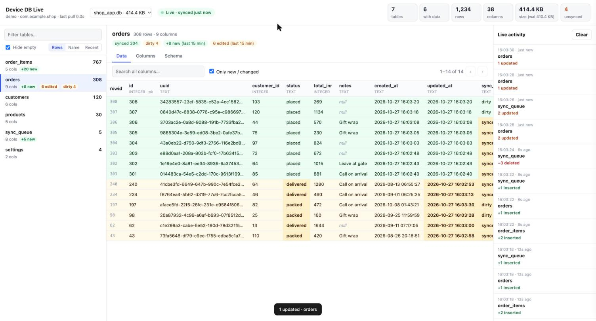
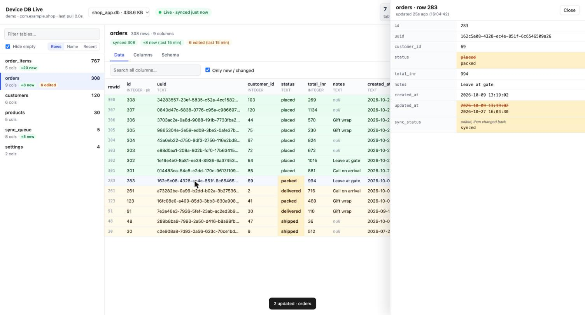
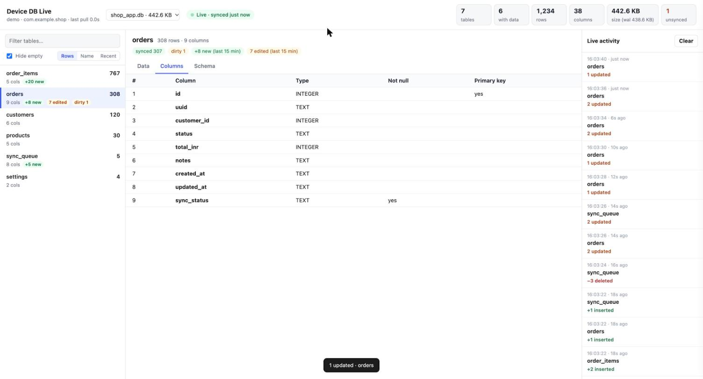
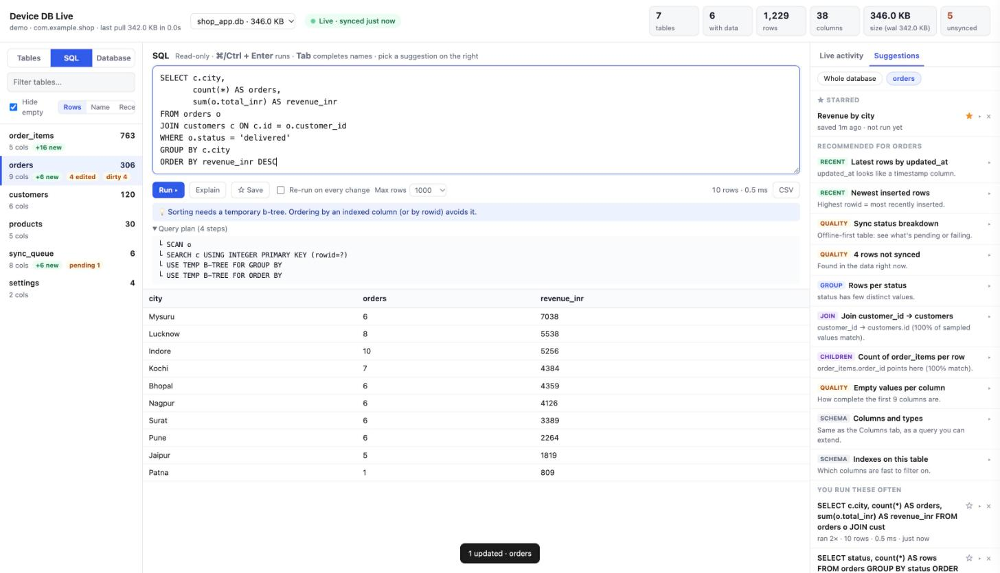
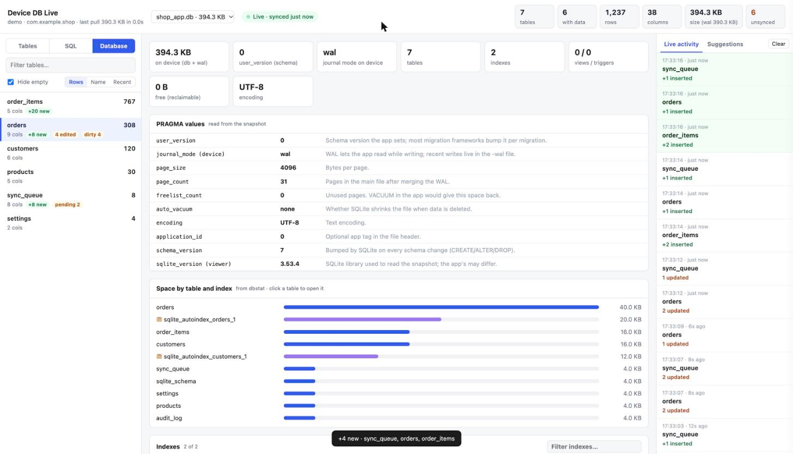
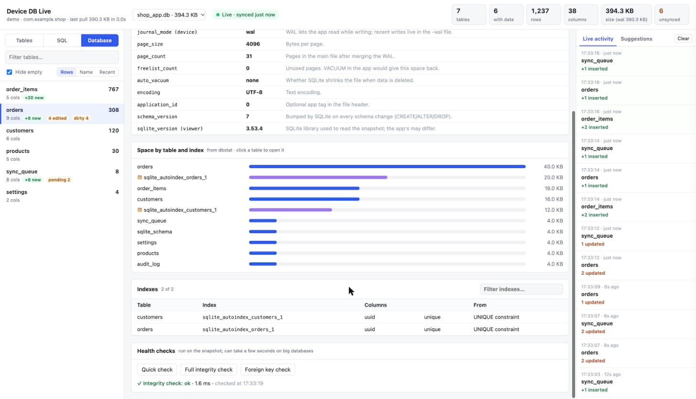

# flutterdb — live view of your app's on-device SQLite database

[](https://github.com/ramanmmm/flutter-db-viewer/actions/workflows/ci.yml)
[](LICENSE)


**One command, from your Flutter project folder, and you're watching the app's
SQLite database in the browser — every table, row count and column, with new
and edited rows lighting up a couple of seconds after you tap *Save* on the
phone.**

```sh
cd my_flutter_app
flutterdb
```



- **Live.** Polls the device every 2 s; only the 4 MB chunks of the database that changed are pulled.
- **Diffs, not dumps.** Inserted rows are green, edited rows amber with the exact cells that changed, deletions in the activity feed.
- **SQL that gets smarter.** A read-only SQL console with schema-aware autocomplete, query recommendations built from *your* data (real joins verified against the rows, sync problems, duplicates, broken links), a query-plan coach, and a per-app history of what you've run and starred.
- **The database itself.** A PRAGMA view: schema version, journal mode, page and free space, space per table and index, every index, and one-click integrity / foreign-key checks.
- **Zero setup in the app.** No package to add, no debug-only code, no network permission. Works on any debug build.
- **Zero dependencies.** Python 3.9+ standard library and `adb`. Nothing to `pip install`.
- **Read-only.** Never writes to the device. Your app's data is copied to a temp dir on your machine and deleted when you stop.

---

## Contents

- [Why](#why)
- [Install](#install)
- [Quick start](#quick-start)
- [What you see](#what-you-see)
- [SQL console](#sql-console)
- [Database view (PRAGMA)](#database-view-pragma)
- [Commands and options](#commands-and-options)
- [Use it in a team project](#use-it-in-a-team-project)
- [Supported setups](#supported-setups)
- [How it works](#how-it-works)
- [Troubleshooting](#troubleshooting)
- [Development](#development)
- [License](#license)

## Why

When you build an offline-first app you constantly ask *"did that save?
what's in the table now? did sync clear the dirty flag?"*. The usual answers
are slow:

| Approach | Pain |
|---|---|
| `adb pull` + DB Browser for SQLite | A stale snapshot. Re-pull and re-open after every tap. WAL files are easy to forget, so recent writes go missing. |
| Android Studio **App Inspection → Database Inspector** | Only sees databases opened through Android's framework SQLite. Flutter apps using `sqflite_common_ffi`, `drift` + `sqlite3_flutter_libs` or any bundled SQLite often don't show up. Needs Android Studio running. |
| Debug screens / logging in the app | Code you have to write, ship behind flags, and remove. |

`flutterdb` sits in between: it reads the files straight from the app's private
directory over `adb`, so it doesn't care which SQLite library the app uses, and
it diffs every snapshot so you see *what changed*, not just *what is*.

## Install

**macOS / Linux, one line** (installs to `~/.local`, no sudo, no pip):

```sh
curl -fsSL https://raw.githubusercontent.com/ramanmmm/flutter-db-viewer/main/install.sh | sh
```

Pin a release instead of `main`:

```sh
curl -fsSL https://raw.githubusercontent.com/ramanmmm/flutter-db-viewer/main/install.sh | FLUTTERDB_REF=v1.1.0 sh
```

<details>
<summary>Other ways to install</summary>

**pipx / pip**

```sh
pipx install git+https://github.com/ramanmmm/flutter-db-viewer
# or
python3 -m pip install --user git+https://github.com/ramanmmm/flutter-db-viewer
```

(Homebrew and recent Debian/Ubuntu Pythons refuse `pip install --user`; use `pipx` or the one-line installer there.)

**From a clone**

```sh
git clone https://github.com/ramanmmm/flutter-db-viewer
cd flutter-db-viewer
sh install.sh --local        # or run in place: python3 -m flutter_db_viewer
```

**Uninstall**

```sh
curl -fsSL https://raw.githubusercontent.com/ramanmmm/flutter-db-viewer/main/install.sh | sh -s -- --uninstall
```

</details>

**Requirements**

- Python **3.9+** (`python3` — preinstalled on macOS and most Linux distros)
- **adb** on your `PATH` ([Android SDK Platform-Tools](https://developer.android.com/tools/releases/platform-tools); already there if you have Android Studio / Flutter set up)
- A device or emulator with the app installed as a **debug build** (`flutter run` / `flutter install --debug`)

## Quick start

```sh
cd path/to/your_flutter_app     # flutterdb reads applicationId from android/app/build.gradle(.kts)
flutterdb                       # opens http://localhost:8765
```

Use the app on the phone. Within ~2 seconds the page shows the change.

No phone handy? Try the built-in demo — a fake shop app that keeps placing
and updating orders:

```sh
flutterdb --demo
```

Just want numbers in the terminal?

```text
$ flutterdb --once
emulator-5554 · com.example.shop  ·  databases/shop_app.db
size 4.0 KB + wal 181.1 KB  ·  7 tables (5 with data)  ·  1,201 rows  ·  0 unsynced

table            rows  cols  sync
order_items       747     5
orders            300     9  synced:300
customers         120     6
products           30     5
settings            4     2
audit_log           0     3
sync_queue          0     8
```

Stop it with **Ctrl+C**, or from any terminal:

```sh
flutterdb stop          # inside a project: that app's viewer; elsewhere: all
flutterdb list          # what's running, on which port
```

## What you see

**Header** — tables, tables with data, total rows, total columns, database size
(main file + WAL), and *unsynced*: rows whose `sync_status` column isn't
`synced` (handy for offline-first apps; ignored if your tables don't have one).
The dropdown switches between the app's databases (e.g. dev / staging flavours).

**Left** — every table with row and column counts, sync-status badges, and a
`+N new` / `N edited` badge for the last 15 minutes. Filter, hide empty tables,
sort by size, name or most recently changed.

**Middle** — the rows, newest first, 100 per page. Search across all columns,
click a header to sort. Tabs for **Columns** (name, type, not-null, primary key)
and **Schema** (the `CREATE TABLE` SQL).

**Right** — the live activity feed: every change, per table, with
inserted / updated / deleted counts. Click one to jump to those rows.

| Only new / changed rows | Row detail — old value struck through |
|---|---|
|  |  |

| Columns tab |
|---|
|  |

Tick **Only new / changed** to see just the rows touched since you started
watching. Click any row for every field in full (JSON is pretty-printed);
edited fields show their value before the first edit, struck through.

The **Columns** tab also lists the table's indexes, foreign keys and triggers,
and marks which columns are indexed. **Query in SQL ▸** opens the table in the
SQL console.

## SQL console

Switch to **SQL** in the top-left. Write any read-only query against the live
snapshot — `SELECT`, `WITH … SELECT`, `EXPLAIN QUERY PLAN`, read-only `PRAGMA`s
(`table_info`, `index_list`, `integrity_check`, `user_version`, …).



- **Autocomplete** — table names after `FROM`/`JOIN`, columns of the tables in
  your query (aliases understood: `o.` lists `orders`' columns), keywords,
  functions, PRAGMA names. <kbd>Tab</kbd>/<kbd>Enter</kbd> accepts,
  <kbd>Ctrl</kbd>+<kbd>Space</kbd> opens it, <kbd>⌘/Ctrl</kbd>+<kbd>Enter</kbd> runs.
- **Recommendations** (right panel, per table or whole database), generated
  from the schema *and checked against the data*:
  - **joins** — e.g. `village → docs__village.server_name (100% of sampled values match)`;
    found from declared foreign keys, `*_id` / `*_uuid` naming, Frappe-style
    `parent_uuid` + `parent_doctype` child tables, and link columns that hold
    another table's key. Only links that actually match the rows are offered;
  - **children** — per-row counts of tables that point at this one;
  - **broken links** — rows whose link value doesn't exist in the target table;
  - **sync** — status breakdowns and rows not yet synced;
  - **breakdowns** — `GROUP BY` for low-cardinality columns (status, type, gender…);
  - **duplicates** — only offered when duplicates really exist;
  - **completeness** — empty values per column; latest rows by timestamp; schema and index queries.
- **History that compounds** — every query you run is kept per app
  (`~/.local/share/flutterdb/history/<app>.json`): *Recent*, *You run these
  often*, and **☆ Save** to star the ones worth keeping. Next session they're
  all one click away.
- **Plan coach** — after each run you get the query plan and plain-language
  tips: *"Full scan of docs__survey (28,641 rows) to filter on gender — an index
  on docs__survey(gender) in the app's schema would make this a SEARCH"*,
  temp b-tree sorts, correlated subqueries, missing `LIMIT`, leading-`%` `LIKE`.
- **Re-run on every change** turns any query into a live dashboard of the app's data.
- **CSV** export of the result; click a result row for the full record.

Safety: queries run on the local snapshot, never the device, through an
SQLite authorizer that only permits reads (no `INSERT`/`UPDATE`/`DELETE`/DDL,
no `ATTACH`, no extensions, no PRAGMA writes), with a 15 s time limit and a
row cap.

## Database view (PRAGMA)

Switch to **Database** for the file-level picture:

| Overview and PRAGMA values | Space, indexes and health checks |
|---|---|
|  |  |

- `user_version` (the schema version most migration tools bump), the
  **device's** journal mode (read from the file header — WAL or rollback),
  page size and count, **free pages** a `VACUUM` would reclaim, auto-vacuum,
  encoding, application id, schema cookie.
- **Space by table and index** (via SQLite's `dbstat`), largest first — click a
  table to open it.
- **Every index** with its columns, uniqueness and origin (`CREATE INDEX`,
  `PRIMARY KEY`, `UNIQUE`), filterable.
- **Health checks** on demand: `quick_check`, full `integrity_check`,
  `foreign_key_check`.

## Commands and options

```text
flutterdb [options]              start (or re-open) the viewer
flutterdb stop [--package P | --all]
flutterdb list
```

| Option | Default | What it does |
|---|---|---|
| `--package com.x.y` | from `android/app/build.gradle(.kts)` | App to read. Lets you run it from anywhere. |
| `--db NAME` | the app's largest database | Pick a database by file name (`app.db`) or path (`app_flutter/app.db`). Switchable in the page too. |
| `-s, --serial ID` | adb's default | Device to use when several are connected (`adb devices`). |
| `--port N` | `8765` | First port to try; the next free one is used if it's taken. |
| `--interval S` | `2.0` | Seconds between checks. |
| `--once` | | Print the summary table and exit. |
| `--no-open` | | Don't open the browser. |
| `--demo` | | Run against the built-in demo app. |
| `--dir PATH` | | Read `.db` files from a local folder instead of a device. |
| `--version` | | Print the version. |

Running `flutterdb` again for an app that is already being watched just
re-opens its page. Several apps can be watched at once; each gets its own port.

## Use it in a team project

Commit a tiny launcher to each app repo so nobody has to remember anything —
the first run installs `flutterdb` (into `~/.local`, not into the project):

```sh
curl -fsSL https://raw.githubusercontent.com/ramanmmm/flutter-db-viewer/main/examples/checkLiveDb.sh -o checkLiveDb.sh
chmod +x checkLiveDb.sh
```

```sh
./checkLiveDb.sh            # open the live page
./checkLiveDb.sh stop       # stop this app's viewer
./checkLiveDb.sh --once     # summary in the terminal
```

The script pins a release (`FLUTTERDB_REF=v1.1.0`) so the whole team runs the
same version; bump it when you want an upgrade. Set `PACKAGE=` at the top if
the app id can't be read from Gradle (e.g. it's computed).

## Supported setups

| | |
|---|---|
| **Host** | macOS, Linux. (Windows: use WSL with `adb` available inside it.) |
| **Device** | Physical Android device or emulator, any API level with `run-as` (all modern ones). |
| **App build** | Debug (`android:debuggable="true"`). Release builds can't be read — Android's sandbox, by design. |
| **SQLite libraries** | Anything that writes a SQLite file: `sqflite`, `sqflite_common_ffi`, `drift`, `floor`, `sqlite3`, Room, `SQLiteOpenHelper`, … |
| **Where it looks** | `databases/` (Android default), `app_flutter/` (Flutter's documents dir, drift's usual home), `files/` — `*.db`, `*.sqlite`, `*.sqlite3`. |
| **Not supported** | Non-SQLite stores (Hive, Isar, ObjectBox, shared_preferences); encrypted DBs (SQLCipher) — the file is copied but can't be opened; iOS. |

## How it works

```text
 phone (debug build)                         your machine
┌──────────────────────────┐   adb exec-out   ┌────────────────────────────────────────┐
│ /data/data/<app>/        │   run-as <app>   │  flutterdb                             │
│   databases/app.db       │ ───────────────▶ │   1. stat files every 2 s (cheap)      │
│   databases/app.db-wal   │  stat / dd / md5 │   2. pull only the 4 MB chunks whose   │
└──────────────────────────┘                  │      md5 changed (each chunk retried   │
                                              │      on its own if USB hiccups)        │
                                              │   3. snapshot = main + WAL, read-only  │
                                              │   4. hash every row, diff vs. previous │
                                              │   5. push "changed" to the page (SSE)  │
                                              └───────────────┬────────────────────────┘
                                                              │ http://localhost:8765
                                                              ▼
                                                         your browser
```

More detail — the WAL handling, why a checkpoint mid-pull is safe, and the
performance numbers — in [docs/how-it-works.md](docs/how-it-works.md).

**Performance.** On a 100 MB database with 150 tables, 750 indexes and ~170k
rows: first load ≈ 8–9 s over USB (with live progress); after that a typical
change pulls only the touched chunks and shows up in 1–3 s. Row hashing costs
~1.5 s per 170k rows and runs only when the files changed. The database report
takes ~0.1 s and a table's recommendations ~0.2 s.

**Privacy.** The page is served on `127.0.0.1` only and refuses requests for any
other host name (DNS-rebinding protection) and cross-site POSTs. Data never
leaves your machine; the temp copy is removed when the viewer stops. Query
history stays in `~/.local/share/flutterdb/`.

## Troubleshooting

| Message | Fix |
|---|---|
| `run-as: package not debuggable` | Install a debug build: `flutter run` or `flutter install --debug`. |
| `run-as: unknown package` | The app isn't installed on that device, or the id differs (flavour suffix?) — pass `--package` with the id from `adb shell pm list packages`. |
| `no devices/emulators found` | `adb devices` must list the device as `device` (accept the USB debugging prompt). |
| `more than one device/emulator` | Pass `-s <serial>` from `adb devices`. |
| `No SQLite files found` | Open the app once so it creates its database. If it lives somewhere unusual, open an issue. |
| `not inside a Flutter/Android project` | `cd` into the project, or pass `--package`. |
| Page says **Pulling…** for a long time on first load | The message shows progress (`52 / 104 MB`). Large databases take several seconds per 100 MB over USB; USB 2 cables/ports are slower. |
| `adb transfer stalled for 30 s` | A chunk didn't arrive; it's retried 3×, then the whole pull is retried on the next tick. Persistent stalls: replug the cable, or `adb kill-server`. |
| SQL: `Only read-only queries run here` | Writes are never allowed — the console reads a snapshot, not the device. |

More in [docs/troubleshooting.md](docs/troubleshooting.md).

## Development

```sh
git clone https://github.com/ramanmmm/flutter-db-viewer
cd flutter-db-viewer
python3 -m unittest discover -s tests -v     # no device needed
python3 -m flutter_db_viewer --demo          # run from source
```

The code is three files: `flutter_db_viewer/viewer.py` (device access, diff
engine, HTTP server, CLI), `flutter_db_viewer/index.html` (the whole UI, no
build step) and `flutter_db_viewer/demo.py` (the demo app). See
[CONTRIBUTING.md](CONTRIBUTING.md).

## License

[MIT](LICENSE) © 2026 Raman Mishra
